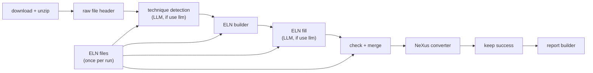

# Zenodo harvest for SPM data

Goal: turn openly licensed scanning probe microscopy (SPM) datasets on [Zenodo](https://zenodo.org)
into [NeXus](https://www.nexusformat.org) files and [NOMAD](https://nomad-lab.eu) projects that link
back to the Zenodo DOI.

The `zenodo_harvest` Action of
[nomad-eosc-galaxy-actions](https://github.com/FAIRmat-NFDI/nomad-eosc-galaxy-actions) decides what to
harvest, starts this workflow and creates the NOMAD projects from its outputs. The workflow only
computes; it writes nothing to NOMAD.



Every step after the download runs once per raw file, except the ELN files step.
If a file's job fails, Galaxy pauses its later jobs, and a paused job can stop the whole run.
So the workflow puts a fixed file of the download step in place of a failed or paused job
([`__KEEP_SUCCESS_DATASETS__`](https://galaxyproject.github.io/foundry/patterns/collection-cleanup-after-mapover-failure/)
with a replacement):

- header → "no header";
- LLM (detection or ELN fill) → "LLM job failed", so the file gets its rule ELN;
- ELN builder → an empty ELN, so the converter reports the file as failed.

The *keep success* steps before the report drop a file whose merge or converter job failed, so
the report still runs and lists it as `failed (no_result)`.

The technique comes from the detection answer if its quote is found in the dataset's files, else from the header
markers of the ELN rules, else from the file extension. The LLM part is on by default and can be
turned off; only LLM values with a quote found in the dataset's files are kept.

The tools are in [`tools/zenodo_nomad_download`](../../tools/zenodo_nomad_download/),
[`tools/pynxtools_spm`](../../tools/pynxtools_spm/) (converter, raw file header, ELN files),
[`tools/nexus_eln`](../../tools/nexus_eln/) and
[`tools/nexus_report_builder`](../../tools/nexus_report_builder/).

## Inputs and outputs

| Name | Content |
|---|---|
| `work list` (input, step 0) | `work_list.json` from the Action |
| `prefetched files` (optional input) | Files already in Galaxy; element identifier = Zenodo file name |
| `use llm` (input, default `true`) | Let [LLM Hub](https://github.com/bgruening/galaxytools/tree/master/tools/llm_hub) fill the empty ELN fields |
| `llm model` (input, default `mistral-medium-3.5-e-infra.cz`) | LLM Hub **multimodal** model (a value of the server's `genai_models` table). The type is fixed to "Multimodal models": Galaxy 25.0 cannot connect an input to LLM Hub's type selector |
| `eln rules`, `eln instructions` (optional inputs) | Used instead of pynxtools-spm's `eln_rules.yaml` and `eln_instructions.md`, e.g. fixes to test before they go into pynxtools-spm |
| `manifest` | Every archive and file, with its role and what happened to it |
| `results` | Conversion status per raw file |
| `projects` | One NOMAD project zip per Zenodo record |
| `logs`, `summary` | A log per record, and an HTML summary of the run |
| `eln files`, `eln reports`, `nexus files`, `conversion statuses`, `converter logs` | Outputs of the middle steps; `eln files` are the ELNs the converter read; `eln reports` say where the technique came from |
| `eln rules used`, `eln instructions used`, `headers` | The ELN files of the run, and each raw file's header |
| `detection answers`, `eln llm reports`, `llm answers` | Per raw file: the LLM's technique answer, the LLM values kept or dropped (with the reason), and the LLM's ELN answer |

The Action reads the outputs by these labels, so keep them when you edit the workflow.

## Files

| File | Use |
|---|---|
| `zenodo-harvest-spm.ga` | Import in Galaxy (*Workflows → Import*, from this file or its raw GitHub URL) |
| `zenodo-harvest-spm.gxwf.yml` | Source ([gxformat2](https://github.com/galaxyproject/gxformat2)); edit this one |
| `zenodo-harvest-spm-tests.yml` | `planemo test` cases for the `.ga` (LLM off) |

After editing the source, regenerate the `.ga` and test it:

```bash
gxwf-to-native zenodo-harvest-spm.gxwf.yml zenodo-harvest-spm.ga
planemo test --conda_auto_install --galaxy_branch release_25.0 \
    --extra_tools ../../tools/zenodo_nomad_download --extra_tools ../../tools/pynxtools_spm \
    --extra_tools ../../tools/nexus_eln --extra_tools ../../tools/nexus_report_builder \
    --extra_tools ../../tools/llm_hub zenodo-harvest-spm.ga
```

The `.ga` uses the tools' short IDs. Once the tools are in the Tool Shed, re-export it from the Galaxy
server so it has their full Tool Shed IDs.

Author: Rubel Mozumder ([FAIRmat](https://www.fairmat-nfdi.eu/fairmat/))
